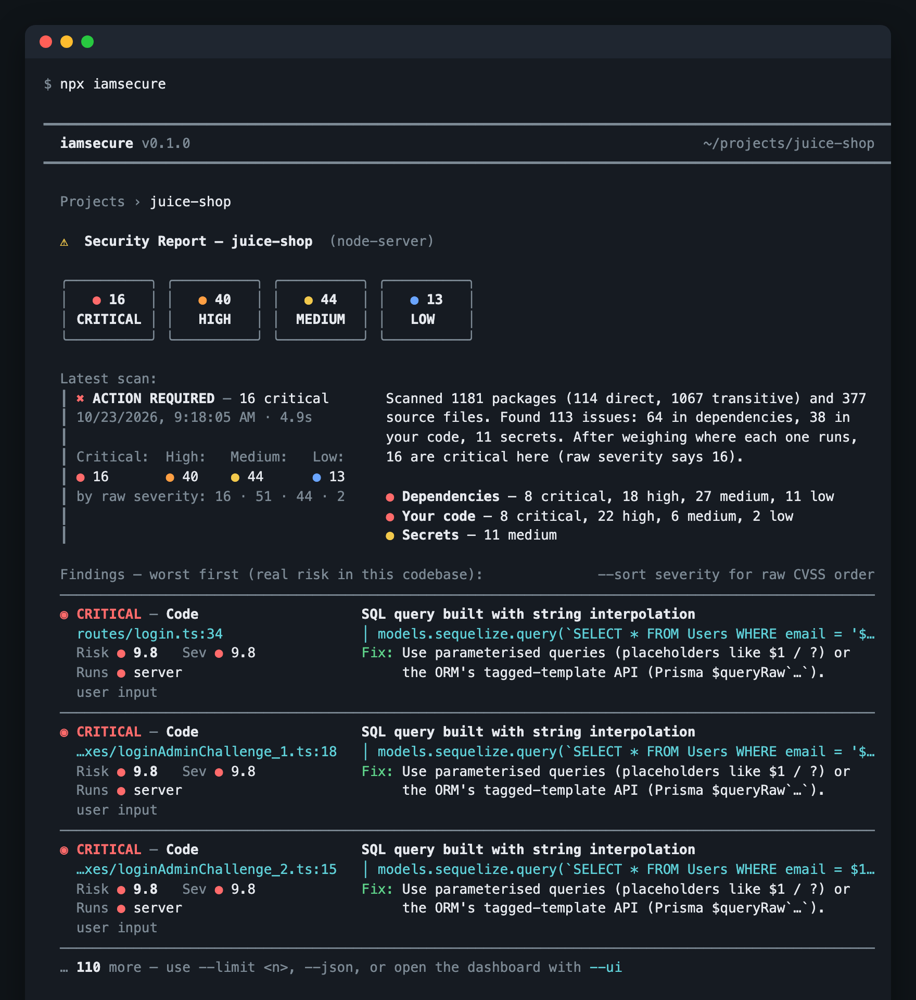
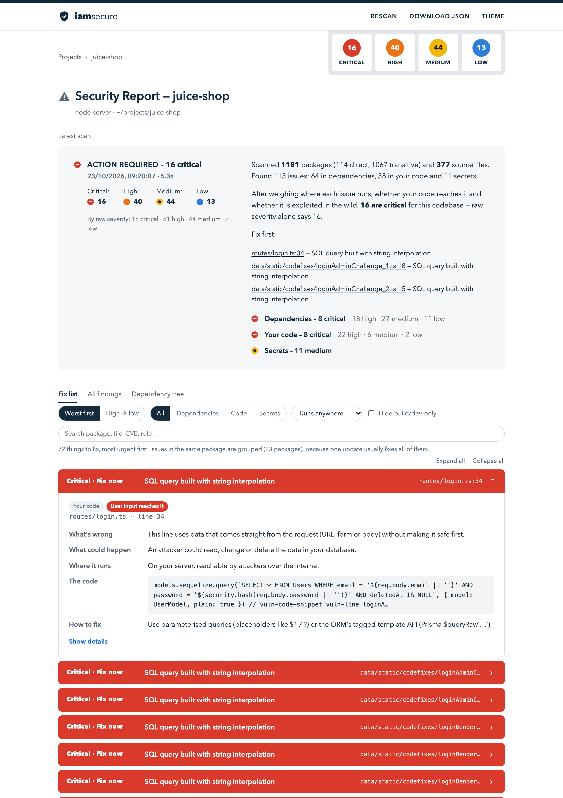
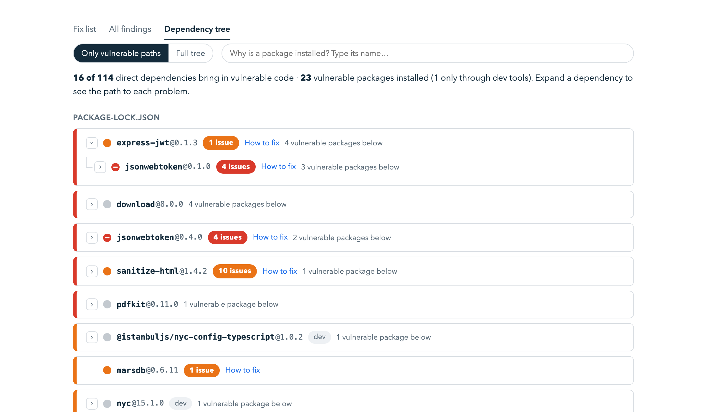

# iamsecure

[](https://www.npmjs.com/package/iamsecure)
[](https://github.com/Ravindrabisht12/iamsecure/blob/main/LICENSE)


**Find vulnerable dependencies and insecure code, ranked by how dangerous they are in *your* app, not just by CVSS.**

```bash
npx iamsecure        # scan the current folder
npx iamsecure --ui   # open the dashboard
```

<p align="center">
  
</p>

Every finding is ranked in two ways:

- **Real risk (worst first)** is the default. It shows how dangerous each issue is for *this* codebase.
- **Severity (high → low)** is the raw CVSS / rule severity, the same thing `npm audit` shows.

The two rankings differ a lot in practice. A 9.8 CVE in a dev-only CLI tool drops to *low*. An 8.1 lodash advisory rises to *critical* because your API route calls the exact `_.template` function the advisory names.

It has **zero runtime dependencies** and needs only Node ≥ 18. A security scanner shouldn't add 300 packages to your supply chain.

### Example: OWASP Juice Shop

A scan of [OWASP Juice Shop](https://github.com/juice-shop/juice-shop), a deliberately vulnerable Node.js app:

| | critical | high | medium | low |
|---|---|---|---|---|
| By raw severity | 16 | 51 | 44 | 2 |
| **By real risk** | **16** | **40** | **44** | **13** |

It covered 1,181 packages and 377 source files in about 5 seconds, and found the app's planted SQL injection in `routes/login.ts`, its `eval`, its path traversal routes and 11 hard-coded secrets.

Twelve "high" findings dropped to medium or low:
- Nine are in `tar`, which is installed but never imported anywhere.
- The rest are in a dev-only build tool and a test file.

One "high" `jsonwebtoken` advisory rose to *critical*, because the server's auth code imports that package.

## Dashboard

`npx iamsecure --ui` opens a local dashboard. Its **Fix list** groups every issue into one action, explains it in plain language (what's wrong, what could happen, where it runs, how to fix) and gives the exact install command.

<p align="center">
  
</p>

The **Dependency tree** shows which of your direct dependencies brings in each vulnerable package. Its search answers "why is this installed?".

<p align="center">
  
</p>

## Quick start

```bash
npx iamsecure                 # scan the current directory, print to terminal
npx iamsecure --ui            # open the interactive dashboard on http://localhost:4477
npx iamsecure --ai claude-cli # let Claude double-check the top findings
```

To get `npm run iamsecure` in a project:

```bash
npm i -D iamsecure
npm pkg set scripts.iamsecure="iamsecure --ui"
npm run iamsecure
```

## What it does

| Step | How |
|---|---|
| 1. Full dependency tree | Parses `package-lock.json` (v1–v3), `yarn.lock` (classic + berry), `pnpm-lock.yaml` (v5–v9), `composer.lock`, `uv.lock`, `poetry.lock`, `Pipfile.lock`, pinned `requirements*.txt`. It records *why* each package is installed (`next › postcss › nanoid`) and whether it's production or dev-only. |
| 2. Known vulnerabilities | Batch-queries [OSV.dev](https://osv.dev), which aggregates GitHub Advisories, npm, PyPA, Packagist and others, including `MAL-` **malicious package** reports. Picks the fix version from the range that contains your version. |
| 3. Your own code | Rules for JS/TS, PHP and Python: command/SQL/template injection, SSRF, path traversal, XSS, open redirect, unsafe deserialization, JWT mistakes, disabled TLS, weak crypto, risky Next.js config, secrets exposed through `NEXT_PUBLIC_*`. It also finds hard-coded secrets and `.env` files that are committed or not gitignored. Lightweight taint tracking tells `exec(userInput)` (critical) apart from `exec("ls")` (not reported). |
| 4. Validate | Context scoring (below), and optionally AI review of the top findings. |

## How "real risk" is calculated

```
risk = severity × exposure × attack vector × exploit intel × reachability  (× AI verdict)
```

- **Exposure** depends on where the code runs. The tool classifies every file as server, browser, both, or build/test. It understands Next.js `app/`, `pages/api`, `'use client'`, middleware, Vite/CRA SPAs, Node servers, Nuxt/SvelteKit/Remix, PHP and Python. A vulnerable package inherits the exposure of the direct dependencies that pull it in.
- **Vulnerability class decides the browser discount.** A ReDoS in browser-only code is ×0.2, because an attacker can only freeze their own tab. SSRF and path traversal in the browser are ×0.25. XSS stays ×0.95. Dev/build-only code is ×0.3. Installed-but-never-imported packages are ×0.5. Malicious packages are always 10, because install scripts run on every machine that installs them.
- **Attack vector.** Advisories that need local access (CVSS `AV:L`) or high privileges score lower.
- **Exploit intel.** A CVE in [CISA KEV](https://www.cisa.gov/known-exploited-vulnerabilities-catalog) (exploited in the wild) gets a floor of 9.0. A high [EPSS](https://www.first.org/epss/) exploitation probability boosts the score.
- **Reachability.** If your code calls a function the advisory names (`_.template`, `jwt.verify`), the risk goes up. If not, it goes down slightly.

Every adjustment adds a plain-English reason that shows in the terminal, the dashboard and SARIF, so the ranking can be explained.

## AI validation (optional)

| `--ai` | Uses | Notes |
|---|---|---|
| `claude-cli` | Your existing Claude Code login | No API key. Runs `claude -p` with all tools disabled. |
| `anthropic` | `ANTHROPIC_API_KEY` | Needs `@anthropic-ai/sdk` installed (loaded only when used). Defaults to `claude-opus-5-5`. |
| `openai` | `OPENAI_API_KEY` | `OPENAI_BASE_URL` works with OpenRouter, Groq, LM Studio, vLLM… |
| `ollama` | Local Ollama | Nothing leaves your machine. |

- Only the finding and the surrounding code snippets are sent, never the whole repo. Run `--ai-dry-run` to see exactly what would be sent.
- The model returns `exploitable / likely / unlikely / not_exploitable` with a confidence, reasoning and a fix. That verdict adjusts the risk score.
- For example, it demoted the Next.js middleware-bypass CVE (EPSS 99%) to "unlikely" because the project has no `middleware.ts`.
- Code and advisory text are passed as untrusted data, which defends against prompt injection.
- Results are cached in `~/.cache/iamsecure`, so re-runs are free.
- In the dashboard, every finding has an **Ask AI** button.

## CI

```yaml
# .github/workflows/iamsecure.yml
name: iamsecure
on: [push, pull_request]
jobs:
  scan:
    runs-on: ubuntu-latest
    permissions: { security-events: write, contents: read }
    steps:
      - uses: actions/checkout@v4
      - uses: actions/setup-node@v4
        with: { node-version: 22 }
      - run: npx iamsecure --sarif --fail-on critical
      - uses: github/codeql-action/upload-sarif@v3
        if: always()
        with: { sarif_file: iamsecure.sarif }
```

The SARIF `security-severity` field is the contextual risk score, so GitHub's alert severities follow the real-risk ranking.

## Options

```
--sort <risk|severity>   ranking order (default risk)
--min <level>            hide findings below critical|high|medium|low
--limit <n>              findings printed in the terminal (default 30)
--ui / --port / --no-open  dashboard (binds 127.0.0.1 only, token-protected API)
--json [file]            full report as JSON
--sarif [file]           SARIF 2.1.0
--fail-on <level>        exit 1 when real risk ≥ level
--ai <provider> / --ai-model / --ai-max <n> / --ai-dry-run
--no-deps / --no-code / --offline-intel
```

Environment variables:
- `IAMSECURE_CACHE_DIR` and `IAMSECURE_NO_CACHE=1` control the cache.
- `IAMSECURE_AI_TIMEOUT` sets the AI timeout in seconds (default 180).
- `IAMSECURE_OPENAI_MODEL` and `IAMSECURE_OLLAMA_MODEL` override those providers' models.

## Layout

```
bin/iamsecure.js          CLI
src/scan.js               orchestrator → report object
src/deps/                 lockfile parsers, dependency graph, OSV client, CVSS
src/code/                 file walker, server/browser classification, rules + taint engine, secrets
src/risk/                 exploit intel (KEV/EPSS) and the risk model
src/ai/                   prompt builder and providers (claude-cli, anthropic, openai, ollama)
src/report/               terminal and SARIF output
src/ui/                   localhost dashboard: fix list, all findings, dependency tree (single HTML file, no CDN)
```

To try it from a clone of this repo, run `node bin/iamsecure.js /path/to/your/project --ui`.

## Limitations

- Code rules are pattern- and taint-based, not a full data-flow engine. Taint tracking is per file and name-based, so two variables with the same name in different scopes can cause false positives. Use `--ai` to triage them.
- The reachability check needs the advisory to name the function. Many advisories don't, and in that case the tool says so.
- Packages are matched against published advisories. A zero-day nobody has reported yet won't show up.
- Python and PHP import usage isn't mapped to packages yet. Their runtime dependencies are treated as server-side.
